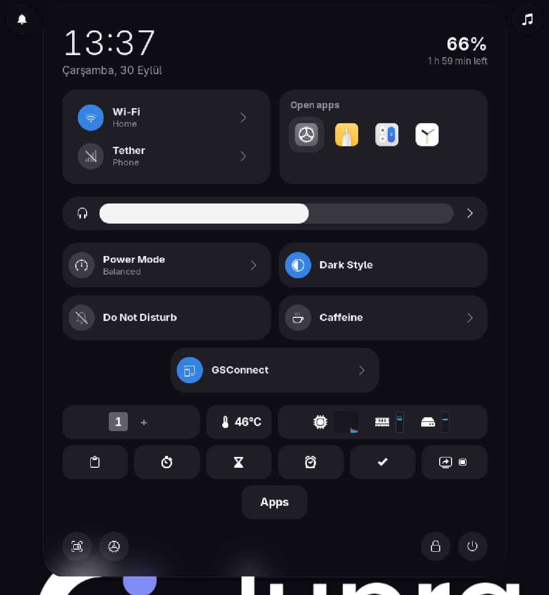

# himura-desktop

My GNOME desktop, in one command: a frosted violet glass look with its own shape (45° cut
corners, thin lavender lines), a dynamic island in the top bar, a dock, desktop widgets,
Windows-style snapping, a file manager and a theme for everything else, all switching
colour together.



```bash
git clone https://github.com/HIMURAw/himura-desktop
cd himura-desktop
./install.sh
```

Then log out and back in.

## What you get

| Part | What it is |
| --- | --- |
| [Dynamic Island](https://github.com/HIMURAw/gnome-dynamic-island) | The top bar as a small glass island: control center, notifications, what is playing |
| [Glass Dock](https://github.com/HIMURAw/gnome-glass-dock) | A dock with magnification, bouncing launches, badges and smart auto-hide |
| [Glass Widgets](https://github.com/HIMURAw/gnome-glass-widgets) | Desktop widgets: weather, calendar, clock, notes, music, system |
| [Glass Windows](https://github.com/HIMURAw/glass-windows) | Cut-corner window frames, snap layouts (`Super+Z`), snap assist, `Super`+arrows |
| [Glass Files](https://github.com/HIMURAw/glass-files) | A file manager laid out like Windows 11 Explorer, in the same look |
| [Mor theme](https://github.com/HIMURAw/mor-theme) | GTK 3, GTK 4 / libadwaita and GNOME Shell theme, plus `tema-rengi` |
| [Mor icons](https://github.com/HIMURAw/mor-icons) | Papirus recoloured to the theme |
| [Away Lock](https://github.com/HIMURAw/gnome-away-lock) | Optional: locks the screen when you walk away (`--with-away-lock`, needs Howdy) |


## One colour for the whole desktop

```bash
tema-rengi turkuaz    # turquoise
tema-rengi yesil      # green
tema-rengi mavi       # blue
tema-rengi mor        # violet (the original)
tema-rengi gri        # grey
```

The island, dock, widgets, window frames and Glass Files change at once; the GTK and Shell
theme, accent colour and wallpaper are rebuilt; the icons are repainted in the background
(2-3 minutes). If you use them, Zen Browser and Spotify ([Spicetify](https://spicetify.app))
follow too; see the [Mor theme](https://github.com/HIMURAw/mor-theme) README for those.

## Does it work on my distro?

It needs **GNOME 50**, not a particular distro. Fedora 44, Ubuntu 26.04 and Arch have it.
The installer knows `dnf`, `apt`, `pacman` and `zypper`; on anything else install the
packages it lists and run `./install.sh --no-deps`.

It does not work on KDE, Xfce or other desktops, and the extensions are not tested on
GNOME 49 or older (`--force` lets you try).

## Options

```bash
./install.sh --no-deps               # you installed the packages yourself
./install.sh --with-away-lock        # also Away Lock
./install.sh --default-file-manager  # Glass Files opens your folders
./install.sh --force                 # GNOME other than 50, at your own risk
```

The installer turns off docks and top-bar extensions that clash (Ubuntu Dock, Dash to Dock,
Dash2Dock, Dash to Panel) and tells you which.

Everything lives in your home folder; only the distro packages need `sudo`. Sources go to
`~/.local/src`; run `./install.sh` again to update.

## Uninstall

```bash
./uninstall.sh           # back to GNOME's own look; sources stay
./uninstall.sh --purge   # also delete the sources
```

Your own `~/.config/gtk-4.0/gtk.css`, if you had one, is put back.

## License

GPL-3.0, like every part of the set.
